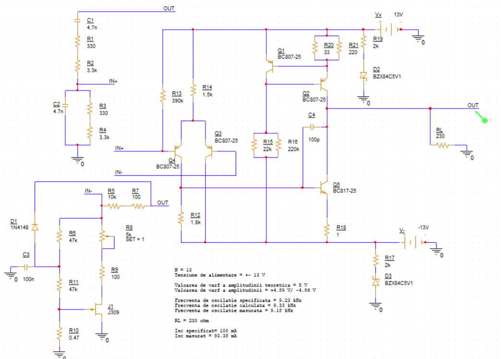

# Wien Bridge Oscillator with Current Limiting and JFET AGC

Design and simulation in OrCAD PSpice of an RC Wien bridge oscillator. The output amplitude is stabilised automatically by a JFET in an AGC (automatic gain control) loop, and the output stage is built to limit the short-circuit current. All parameters are derived from the assigned number **N = 13**.



## Specifications and results

| Parameter | Formula | Specified (N = 13) | Achieved |
|---|---|---|---|
| Supply voltage | ± N V | ± 13 V | ± 13 V |
| Peak amplitude | Vi / 2 − 1.5 V | 5 V | +4.89 V / −4.86 V |
| Oscillation frequency | 120 / N kHz | 9.23 kHz | 9.18 kHz (calculated: 9.33 kHz) |
| Load resistance | 3 / N kΩ | ≈ 230 Ω | 230 Ω |
| Short-circuit current (Isc) | specified | 100 mA | 93.38 mA |

## How it works

- **Wien network (positive feedback).** C1 = C2 = 4.7 nF and R = 3.63 kΩ (330 Ω + 3.3 kΩ in each arm) set the frequency: f = 1 / (2πRC) ≈ 9.33 kHz. The amplifier's phase lag pulls the measured value slightly lower.
- **Discrete amplifier.** PNP differential input pair (BC807-25), a common-emitter NPN output stage (BC817-25, 1 Ω emitter resistor) and a PNP current-source load (BC807-25). A 390 kΩ resistor from V+ to the non-inverting input corrects the DC level of the output.
- **AGC loop.** A 1N4148 peak detector with a 100 nF filter capacitor drives the gate of a J309 JFET, which acts as a voltage-controlled resistor in the negative-feedback divider. The closed-loop gain settles at ≈ 3, which compensates the 1/3 attenuation of the Wien network. When the amplitude grows, the JFET resistance grows, the gain drops and the amplitude stabilises near 5 V.
- **Amplitude trimming.** A potentiometer in the lower leg of the feedback network allows fine adjustment of the steady-state amplitude.
- **Short-circuit behaviour.** The output stage limits the current delivered into a short circuit to roughly 100 mA (93.38 mA measured).

## Simulations

All plots are in [`images/`](images/):

- **Transient analysis:** start-up of the oscillation and steady-state amplitude (`tranzitoriu.png`).
- **AC analysis (Bode plot):** amplifier gain and phase (`Banda si Faza.jpg`).
- **DC sweep vs. supply voltage Vi:** the DC output stays within ±100 mV from 2 V to 30 V (`dc_vs_vi.jpg`).
- **DC sweep vs. temperature** (`dc_vs_temperature.png`).

## How to run

1. Open `orcad/P1_IAD.opj` in OrCAD X (tested with PSpice 26.1).
2. Select a simulation profile (transient, AC sweep or DC sweep) and run it.

Without OrCAD, the exported netlist `orcad/SCHEMATIC1.net` can be used in any SPICE-compatible simulator (the BC807/BC817 and J309 models must be available).

## Repository structure

```
.
├── README.md
├── docs/
│   └── Report_P1.pdf        # full project report (in Romanian)
├── img/                     # schematic and simulation plots
├── orcad/                   # OrCAD project, schematic and netlist
└── .gitignore
```

## Documentation

The full project report, with calculations, component values and discussion of the problems encountered, is in [`docs/Prezentare.pdf`](docs/Prezentare.pdf) (in Romanian).
